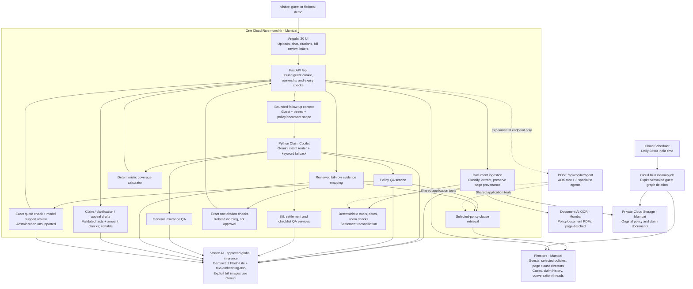
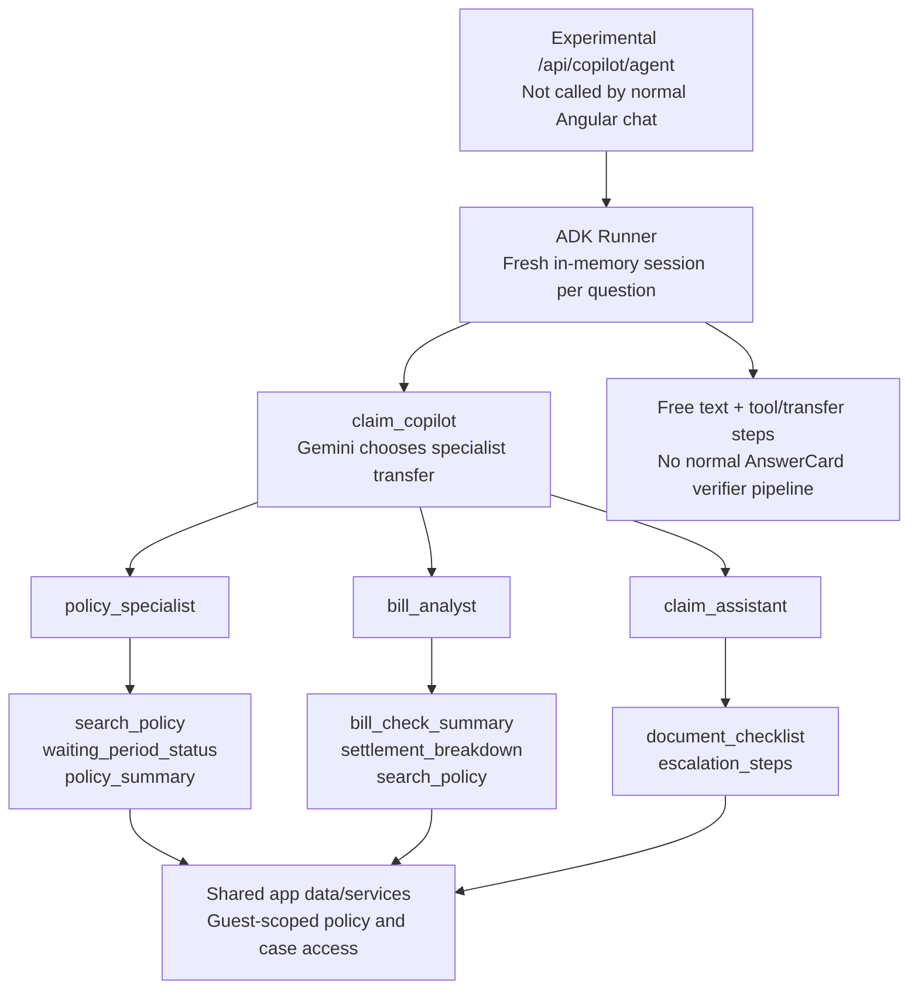
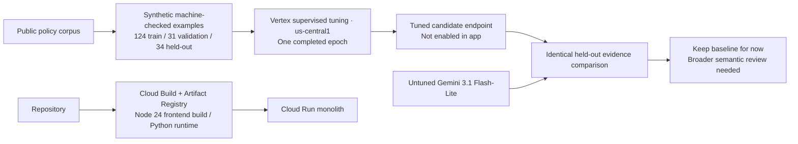

# CareNest current architecture

Verified against source on 14 October 2026. Live revision `carenest-00008-7wp`
serves the untuned Gemini 3.1 Flash-Lite workflow, including policy answer support
checking. The default app uses Python orchestration. ADK is a separate experimental
endpoint and is not called by the Angular chat service.

## Deployed application

Chat streams progress and an answer card through `/api/copilot/ask/stream`; JSON
clients use `/api/copilot/ask`. Labels such as “Policy Specialist” and “Verifier”
in this default path are service/progress labels, not evidence of an ADK transfer.

The semantic support guard currently applies to **policy QA**. Case answers and
bill-row evidence have their own source/quote checks; do not describe every output
as having passed the new semantic guard. Arithmetic remains backend code.
Firestore vector retrieval is custom RAG. Managed Vertex RAG Engine, Vertex context
caching and Cloud DLP are not wired into this path. Originals are private but can
contain PII; local text masking is not comprehensive de-identification.

## What ADK actually contains

This is real ADK agent configuration, but the original diagram's complete agent
architecture has not been made the default. There is no separate ADK rejection
specialist or ADK self-checking verifier. `bill_analyst` handles settlement/rejection
questions, and the robust policy verifier belongs to the Python answer-card path.
ADK uses `InMemorySessionService`, a fixed internal user label `demo` and a new
session per request; it does not implement the normal guest-scoped follow-up threads.
Its live correctness/transfer/isolation acceptance has not been established here.

## Training and release path

The tuning comparison produced baseline 33/34 and tuned 34/34 exact-quote checks;
it does not establish broad insurance accuracy or end-to-end superiority. A new
policy is ingested and retrieved in either design; it does not need retraining.
See `TUNING_COMPARISON.md` for limitations and the promotion decision.

## Source navigation

- Frontend entry: `frontend/src/app/services/api.service.ts` (streaming chat).
- Normal routing: `backend/app/routers/copilot.py`, `services/copilot.py`.
- Follow-ups and policy checks: `services/conversation.py`, `policy_qa.py`, `answer_support.py`.
- Bill evidence: `services/bill_policy.py`; calculations: `coverage.py`, `bill_checks.py`, `settlement_checks.py`.
- ADK team/tool wrappers: `backend/app/adk_copilot.py`, `agent_tools.py`.
- Clients, regions and lifecycle: `backend/app/core/gcp.py`, `config.py`, `app/cleanup.py`.
- Source deploy/build: `scripts/deploy.sh`, `Dockerfile`; cleanup schedule: `infra/configure-guest-cleanup.sh`.
